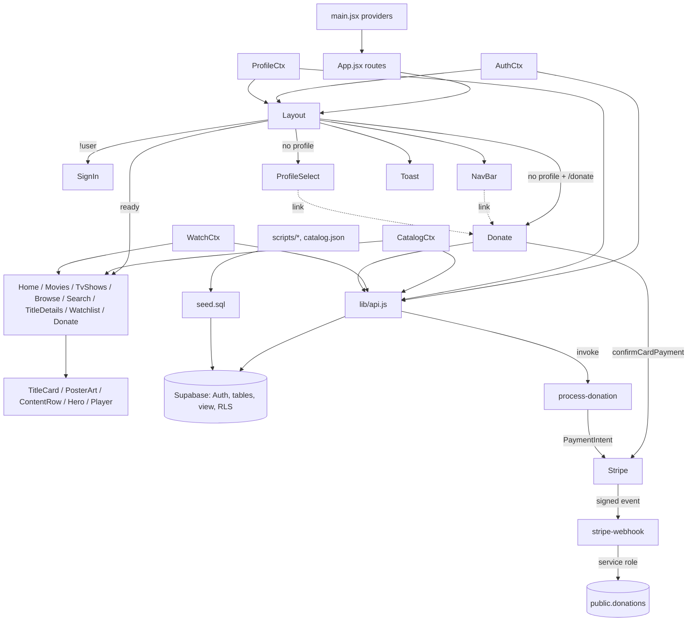

# Streetflix Roadmap

Paths are repo-relative. Line numbers marked "~" are approximate (from a grep) and may drift as code changes.

**Analogy.** Streetflix is a neighbourhood cinema.
- The lobby doorman checks your ticket (Layout and Auth).
- You pick your seat card (Profiles).
- The shelves of films are the Catalog.
- Your personal "to watch" notepad is the Watchlist.
- The projector room is the Player.
- A tip jar at the exit (Donate) hands the money to a bank (Stripe). The bank sends the cinema a signed receipt (webhook), which goes into the ledger (`donations`).
- One back-office window (`lib/api.js`) handles every request to the warehouse (Supabase).

---

## 1. Entry, providers and routing

| File | Responsibility |
|---|---|
| `front-end/src/main.jsx` | Mounts `BrowserRouter` > `AuthProvider` > `ProfileProvider` > `CatalogProvider` > `WatchlistProvider` > `App`. |
| `front-end/src/App.jsx` (13-29) | One layout route (`Layout`) wrapping `/`, `movies`, `tv-shows`, `browse`, `search`, `titles/:id`, `watchlist`, `donate`, `*` (NotFound). |
| `front-end/src/components/Layout.jsx` (13-58) | Gatekeeper, in order: `!ready` → "Checking your session…"; `!user` → `SignIn`; `!profile && /donate` → standalone `Donate` with a Back link; `!profile` → `ProfileSelect`; otherwise `NavBar` + `<main>` + `Toast`. `<Outlet/>` renders only when the catalog is `ready` (skeleton/error with retry otherwise). Scrolls to top on path change. |

- **Inputs:** `useAuth()`, `useProfile()`, `useCatalog()`.
- **Depends on:** Auth, Profiles, Catalog, Donations, Shared components. **Feeds:** every page.

## 2. Auth

| File | Responsibility |
|---|---|
| `front-end/src/context/AuthContext.jsx` (`AuthProvider` ~10, `useAuth` ~39) | Exposes `ready`/`user`. Subscribes to `onAuthChange`; calls `verifyUser()` once per login. 401/403 or a different user → `signOutLocally`; network failure → keeps the stored session. |
| `front-end/src/pages/SignIn.jsx` + `.css` | Log in / Create account. Sign-up sends username and avatar as metadata. |
| `front-end/src/lib/api.js` (16-48) | `onAuthChange`, `verifyUser`, `signOutLocally`, `signIn`, `signUp`, `signOut`. |
| `supabase/schema.sql` (~52) | `on_auth_user_created` trigger → `handle_new_user()` creates the first profile. |

- **Output:** `user`. **Feeds:** Layout, Profiles, Watchlist, Donate (`user.id`).

## 3. Profiles

| File | Responsibility |
|---|---|
| `front-end/src/context/ProfileContext.jsx` | Chosen profile, in memory only; cleared when `profile.owner_id !== user.id`. |
| `front-end/src/pages/ProfileSelect.jsx` (`AddProfile` ~78) | "Who's watching?" picker: list/add profiles, Sign out, coffee-mug `/donate` link (~30). |
| `front-end/src/data/avatars.js`, `front-end/public/avatars/` | Avatar choices. |
| `front-end/src/lib/api.js` (53-63) | `fetchProfiles`, `createProfile` (`owner_id` defaults to `auth.uid()`). |
| `supabase/schema.sql` (`users` 18, policies ~179-189) | One login → many profiles; owner-only RLS. |

- **Output:** `profile` (its `id` keys the watchlist). **Feeds:** Layout, NavBar, Watchlist.

## 4. Catalog (runtime)

| File | Responsibility |
|---|---|
| `front-end/src/context/CatalogContext.jsx` | Fetches once; exposes `CATALOG/MOVIES/SHOWS/GENRES/getTitle/relatedTo`, `status`, `retry`. |
| `front-end/src/data/catalog.js` | Pure helpers incl. per-id `hue`. App code never imports `catalog.json`. |
| `front-end/src/lib/api.js` (~68) | `fetchCatalog` from the `catalog_titles` view. |
| `supabase/schema.sql` | `titles` (57), `genres` (83), `title_genres` (90), view `catalog_titles` (130), public-read policies (165-169). |

- **Feeds:** Layout, Home, Browse, Search, TitleDetails, Watchlist.

## 5. Watchlist and toast

| File | Responsibility |
|---|---|
| `front-end/src/context/WatchlistContext.jsx` | Active profile's slugs; `useWatchlist()` → `ids/loading/has/add/remove/toggle/notify`. Optimistic writes with rollback + error toast; reloads on profile change, tagged by owner. |
| `front-end/src/components/Toast.jsx` + `.css` | In-memory toast. |
| `front-end/src/pages/Watchlist.jsx` + `.css` | "My List" grid (reuses `.browse-grid`). |
| `front-end/src/lib/api.js` (74-92) | `fetchWatchlist`, `addToWatchlist` (upsert `ignoreDuplicates`; no update policy), `removeFromWatchlist`. Take a title **uuid**. |
| `supabase/schema.sql` (`watchlist_items` 106, policies ~197-205) | Owner-only select/insert/delete. |

## 6. Playback

| File | Responsibility |
|---|---|
| `front-end/src/components/Player.jsx` + `.css` | `<dialog>` with YouTube-nocookie/archive.org iframe, Full screen, open-in-new-tab, episode picker by season. |
| `front-end/src/components/Hero.jsx` | Play button. |
| `front-end/src/pages/TitleDetails.jsx` + `.css` | Play/Watch and Trailer. |

## 7. Search

`front-end/src/pages/Search.jsx` + `.css`: title-substring match on `?q=`, split into Movies / TV Shows; empty queries don't change the URL.

## 8. Browse pages

| File | Responsibility |
|---|---|
| `front-end/src/components/BrowsePage.jsx` + `.css` | Shared page: `?genre=` filter, Load More by 8, reset via `key={genre}`. |
| `front-end/src/pages/Movies.jsx`, `TvShows.jsx` | Thin wrappers passing `MOVIES`/`SHOWS`. |
| `front-end/src/pages/Browse.jsx` + `.css` | All titles A–Z, grouped by letter (ignores "The"). |
| `front-end/src/pages/Home.jsx` + `.css` | Hero + ContentRows. |
| `front-end/src/pages/NotFound.jsx` | 404. |

## 9. Shared components

| File | Responsibility |
|---|---|
| `front-end/src/components/TitleCard.jsx` (`PosterArt`, `TitleCard`) | The one card; whole card is a link; optional `onRemove`. `PosterArt` = poster + skeleton, gradient fallback. |
| `front-end/src/components/ContentRow.jsx` | Horizontal scroll row. |
| `front-end/src/components/Hero.jsx` | Featured banner. |
| `front-end/src/components/NavBar.jsx` (`AccountMenu`, `NavBar`) | Top nav / bottom tab bar under 768px; account menu (email, Switch profile, Log out); coffee-mug `/donate` link (~79). |

## 10. Donations (end to end)

1. **Entry points:** mug links in `NavBar.jsx` (~79) and `ProfileSelect.jsx` (~30). `Layout.jsx` (28-35) renders `/donate` standalone when no profile is chosen; `App.jsx` (24) renders it inside the normal layout otherwise.
2. **`front-end/src/pages/Donate.jsx`**
   - `PRESETS` (11), `MIN_CENTS`/`MAX_CENTS` (12-13), `money` (32), `parseCustom` (35).
   - `CARD_MESSAGES` (17), `cardMessage` (28): friendly card-error text.
   - `stripePromise = loadStripe(VITE_STRIPE_PUBLISHABLE_KEY)` (9); `<Elements>` wraps `DonateForm` (54); `Donate` (150) is the page shell.
   - `submit` (68): `createDonationIntent(cents, user.id)` → `stripe.confirmCardPayment(secret, { payment_method: { card } })`. Card data goes straight to Stripe.
   - Errors: `server` 400 → range message; other `server` → generic; `network` → retry button.
3. **`front-end/src/lib/api.js` `createDonationIntent` (100-113):** `supabase.functions.invoke('process-donation', { body: { amount, user_id } })` → `client_secret`, or throws `{ kind: 'network' }` / `{ kind: 'server', status, message }`.
4. **`supabase/functions/process-donation/index.ts`** (`verify_jwt: true`): `auth.getUser()` (401), `user_id` must match (403), integer amount `MIN_AMOUNT = 50`..`MAX_AMOUNT = 1_000_000` (12-13; 400). Creates a USD card PaymentIntent with `metadata.user_id` (49-55), returns `client_secret`.
5. **Stripe** charges the card and POSTs a signed event to the webhook.
6. **`supabase/functions/stripe-webhook/index.ts`** (`verify_jwt: false`; `STRIPE_WEBHOOK_SECRET` signature check): handles `payment_intent.succeeded` / `payment_intent.payment_failed`, reads `metadata.user_id`, writes with the service-role client. Idempotent on `stripe_payment_intent_id`: `failed` can upgrade to `succeeded`, never the reverse; a 23505 race is handled.
7. **`public.donations`** (`supabase/schema.sql` ~232-252): `id`, `user_id` (cascade), `amount` (cents), `stripe_payment_intent_id` (unique), `status` (`succeeded`/`failed`), `created_at`. RLS: authenticated users select only their own rows; no client writes; `service_role` has select/insert/update.

The limits live in two places (`Donate.jsx` for UX, `process-donation` for enforcement); change them together. Nothing in the app reads `donations` back yet.

## 11. Data layer

- **Gateway:** `front-end/src/lib/api.js` is the only place that calls Supabase. `check` (7) turns `{ data, error }` into a thrown error. Sections: Auth (12), Profiles (50), Catalog (65), Watchlist (71), Donations (94). Client in `front-end/src/lib/supabase.js`.
- **Schema:** `supabase/schema.sql` (keep in sync with live). Tables `users`, `titles`, `genres`, `title_genres`, `watchlist_items`, `watched_titles` (unused by the UI), `donations`; trigger `on_auth_user_created`; view `catalog_titles`; RLS policies. Never drop `public.rls_auto_enable()`.
- **Seed:** `supabase/seed.sql` (catalog rows).
- **Edge Functions:** `supabase/functions/process-donation`, `supabase/functions/stripe-webhook`, deployed with the Supabase MCP `deploy_edge_function`.
- **Allowed external requests besides `api.js`:** video/trailer iframes and Stripe.js.

## 12. Catalog tooling (offline)

| File | Responsibility |
|---|---|
| `front-end/scripts/catalog-sources.json` | Hand-curated free titles (movies `ia`; shows `seasons`/`episodes`; overrides `setGenres`, `dropGenres`, `query`, `minMin`). |
| `front-end/scripts/build-catalog.mjs` | Adds TMDB metadata, posters/backdrops, verifies links, prunes small genres, writes `front-end/src/data/catalog.json`. Slow; caches in `scripts/.verify-cache.json`. |
| `front-end/scripts/catalog-to-sql.py` | `catalog.json` → SQL inserts for `seed.sql` / `apply_migration`. |
| `front-end/scripts/fetch-tmdb.mjs` | Superseded. Do not run. |

**Flow:** `catalog-sources.json` → `build-catalog.mjs` → `catalog.json` + `public/posters|backdrops` → `catalog-to-sql.py` → `seed.sql` → Supabase tables → `catalog_titles` → runtime Catalog. ids follow source order; restart the dev server after a rebuild.

## 13. Styling

- **Tokens:** `front-end/src/index.css` `:root` (palette `--bg`/`--accent`/`--crown`, fonts Anton/Permanent Marker/Inter, `--spray-stroke`, `--nav-h`, `--tabbar-h`, `--gutter`) and the global `prefers-reduced-motion` override.
- **Per-component CSS** next to each component/page.
- **Conventions:** text on pink uses `--on-accent`; <768px uses a bottom tab bar with `.page` padding; `.browse-grid` lives in `BrowsePage.css` and is reused by Browse, Search and Watchlist.

---

## Dependency diagram

## Where to change X

| Task | Where |
|---|---|
| Add a route or page | New `front-end/src/pages/X.jsx` (+ CSS); `<Route>` in `front-end/src/App.jsx` above `*`; nav link in `NavBar.jsx`. |
| Add a Supabase call | New export in `front-end/src/lib/api.js` using `check`; call it from a context/page; add a policy in `supabase/schema.sql` for new tables. |
| Change the donation limits | `MIN_CENTS`/`MAX_CENTS` in `Donate.jsx` (12-13) and `MIN_AMOUNT`/`MAX_AMOUNT` in `process-donation/index.ts` (12-13), then redeploy; also the "$0.50 / $10,000" copy and placeholder in `Donate.jsx`. |
| Change donation preset buttons | `PRESETS` in `Donate.jsx` (11). |
| Change currency or payment methods | `paymentIntents.create` in `process-donation/index.ts` (49-55). |
| Change donation error messages | `CARD_MESSAGES`, `GENERIC_ERROR`, `NETWORK_ERROR` in `Donate.jsx` (14-30). |
| Record more Stripe events | Status mapping in `stripe-webhook/index.ts` (35-38); a new status also needs the `donations.status` check in `schema.sql`. |
| Add a catalog title | `catalog-sources.json` → `build-catalog.mjs` → `catalog-to-sql.py --new-only` → `apply_migration`; update `seed.sql`; restart the dev server. |
| Change the gating order | `front-end/src/components/Layout.jsx` (19-37). |
| Change session validation | `verifyUser` in `api.js` and `AuthContext.jsx`. |
| Change what a profile has | `public.users` in `schema.sql`, `fetchProfiles`/`createProfile` in `api.js`, `AddProfile` in `ProfileSelect.jsx`. |
| Add or change avatars | `front-end/src/data/avatars.js`, `front-end/public/avatars/`. |
| Change watchlist behaviour | `WatchlistContext.jsx` and the watchlist functions in `api.js` (74-92). |
| Change the player | `front-end/src/components/Player.jsx`. |
| Change search matching | `matches` in `front-end/src/pages/Search.jsx`. |
| Change browse page size or filter | `front-end/src/components/BrowsePage.jsx`. |
| Change colours, fonts or spacing | `:root` in `front-end/src/index.css`; component rules in that component's CSS. |
| Change environment keys | `front-end/.env.local`: `VITE_SUPABASE_URL`, `VITE_SUPABASE_PUBLISHABLE_KEY`, `TMDB_API_KEY` (scripts only). `front-end/.env`: `VITE_STRIPE_PUBLISHABLE_KEY`. Stripe secrets (`STRIPE_SECRET_KEY`, `STRIPE_WEBHOOK_SECRET`) live only in Supabase Edge Function secrets. |
